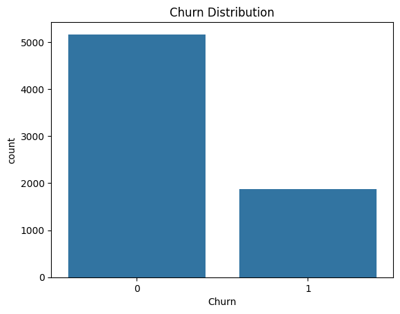
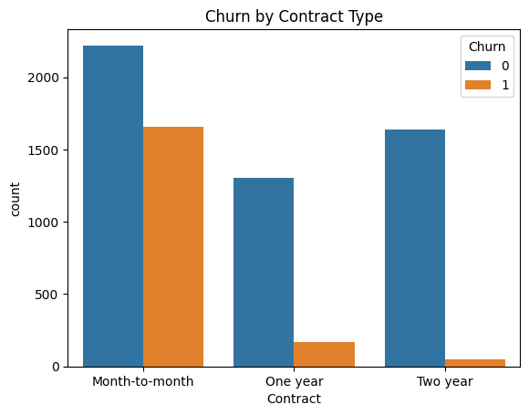

# Customer Retention Analysis: Telecom Churn Prediction


An end-to-end customer churn analysis of 7,043 telecommunications customers using Python, exploratory data analysis, and machine learning. The project identifies customer segments associated with higher churn, examines the factors influencing customer retention, and estimates the monthly recurring revenue associated with churned customers.

The analysis combines business intelligence techniques with an interpretable Logistic Regression model to generate actionable insights for customer retention and revenue protection.

---

## Results at a Glance

| Performance Indicator | Result |
|---|---:|
| Customers Analysed | 7,043 |
| Customer Churn Rate | Approximately 26.54% |
| Monthly Revenue at Risk | **$7,874.00 (verify against notebook)** |
| Classification Algorithm | Logistic Regression |
| Training/Test Split | 80/20 |
| Accuracy | 79% |
| ROC-AUC | 0.83 |
| F1-Score (Churn Class) | 0.56 |

**Key Finding:** Exploratory analysis identified month-to-month subscribers as the customer segment with the highest churn rate. Logistic Regression also identified fiber optic internet subscriptions and electronic check payments as prominent positive predictors of churn.

These findings provide a basis for targeted customer retention strategies and revenue protection initiatives.

---

## 1. Business Problem

Customer churn is a significant challenge in the telecommunications industry. Losing existing subscribers affects recurring revenue, customer lifetime value, and long-term business growth.

Telecommunications companies need to understand which customers are most likely to discontinue their subscriptions, identify the factors associated with customer attrition, and prioritise retention activities.

This project addresses four business questions:

1. Which customer segments have the highest churn risk?
2. Which customer characteristics are associated with churn?
3. How much monthly recurring revenue is associated with customers who leave?
4. What retention strategies could help reduce customer attrition?

### Project Objectives

- Analyse customer behaviour and identify patterns associated with churn.
- Investigate the relationship between customer characteristics and retention.
- Estimate monthly recurring revenue associated with churned customers.
- Develop an interpretable machine learning model for predicting customer churn.
- Translate analytical findings into actionable business recommendations.

---

## 2. Dataset Description

The analysis uses the publicly available IBM Telco Customer Churn dataset, obtained from Kaggle.

**Dataset:** [Telco Customer Churn Dataset](https://www.kaggle.com/blastchar/telco-customer-churn)

| Dataset Attribute | Description |
|---|---|
| Records | 7,043 customer observations |
| Columns | 21 |
| Target Variable | Churn |
| Problem Type | Binary Classification |
| Churned | 1 |
| Retained | 0 |

### Key Variables

| Variable | Description |
|---|---|
| `customerID` | Unique customer identifier |
| `gender` | Customer gender |
| `SeniorCitizen` | Indicates whether a customer is a senior citizen |
| `tenure` | Number of months the customer has stayed |
| `MonthlyCharges` | Monthly subscription charges |
| `TotalCharges` | Total accumulated customer charges |
| `Contract` | Month-to-month, one-year, or two-year contract |
| `InternetService` | DSL, fiber optic, or no internet service |
| `PaymentMethod` | Customer payment method |
| `Churn` | Whether the customer discontinued the service |

---

## 3. Methodology

The project followed a structured data analytics workflow involving data preparation, exploratory analysis, predictive modelling, and business interpretation.

### 3.1 Data Cleaning and Preparation

The following preprocessing activities were performed:

- Inspected the dataset for missing values, inconsistencies, and incorrect data types.
- Converted `TotalCharges` into numeric format and handled resulting missing values.
- Converted categorical variables into appropriate data types.
- Encoded the target variable `Churn` into binary values (1 = Churned, 0 = Retained).
- Applied one-hot encoding to categorical predictors for machine learning.
- Prepared the resulting features for model training.

### 3.2 Exploratory Data Analysis (EDA)

Exploratory analysis was conducted to understand customer behaviour and identify patterns associated with churn.

The analysis focused on:

- Overall customer churn distribution.
- Churn rates across different contract types.
- Customer subscription characteristics.
- Payment methods and internet service categories.
- Monthly recurring revenue associated with churned customers.

### 3.3 Predictive Modelling

Logistic Regression was selected as the classification algorithm because of its interpretability and suitability for binary classification problems.

**Model Configuration**

| Parameter | Configuration |
|---|---|
| Algorithm | Logistic Regression |
| Target Variable | Churn |
| Feature Engineering | One-Hot Encoding |
| Training/Test Split | 80/20 |
| Evaluation | Accuracy, ROC-AUC, F1-Score |

The model was designed to identify customer characteristics associated with churn while providing interpretable coefficients that could support business decision-making.

---

## 4. Exploratory Analysis and Findings

### 4.1 Customer Churn Distribution



Approximately 26.54% of customers discontinued their subscriptions, while the remaining customers were retained.

This indicates an imbalanced classification problem, with retained customers representing the majority class.

A majority-class baseline that predicts every customer as retained would achieve approximately 73.46% accuracy. Therefore, the model's 79% accuracy should be interpreted alongside other evaluation metrics.

### 4.2 Churn by Contract Type



Month-to-month subscribers recorded substantially higher churn rates than customers on one-year and two-year contracts.

This suggests that customers with shorter contractual commitments may be more vulnerable to switching providers.

### 4.3 Monthly Revenue at Risk

Monthly revenue at risk was estimated by summing the monthly subscription charges associated with customers who discontinued their services.

**Calculation:**

```python
revenue_at_risk = df.loc[
    df['Churn'] == 1, 'MonthlyCharges'
].sum()
```

The estimated monthly recurring revenue associated with churned customers was **$7,874.00**, subject to verification against the notebook's final cleaned dataset.

This figure represents the monthly charges associated with churned customers, not an independently verified measure of annual revenue loss.

---

## 5. Model Performance

The Logistic Regression classifier achieved the following results on the held-out test dataset.

| Evaluation Metric | Result |
|---|---:|
| Accuracy | 0.79 |
| ROC-AUC | 0.83 |
| F1-Score (Churn Class) | 0.56 |

### Interpretation

- **Accuracy (0.79):** The model correctly classified approximately 79% of customers in the test dataset.
- **ROC-AUC (0.83):** The model demonstrated good discriminatory ability in distinguishing customers who churned from those who remained.
- **F1-Score (0.56):** The model achieved moderate performance in identifying the churn class, indicating opportunities to improve the balance between precision and recall.

Although the model performed better than the majority-class accuracy baseline, its churn-class F1-score indicates that further optimisation is necessary before operational deployment.

---

## 6. Features Associated with Customer Churn

The Logistic Regression coefficients provide insight into the direction and relative magnitude of associations between customer characteristics and predicted churn.

The following table presents selected features with the largest positive coefficients and their business interpretations.

| Feature | Coefficient | Interpretation |
|---|---:|---|
| `InternetService_Fiber optic` | 1.08 | Strong positive association with churn odds |
| `StreamingMovies_Yes` | 0.36 | Positive association with churn odds |
| `StreamingTV_Yes` | 0.34 | Positive association with churn odds |
| `MultipleLines_No phone service` | 0.34 | Positive association with churn odds |
| `MultipleLines_Yes` | 0.28 | Positive association with churn odds |
| `PaperlessBilling_Yes` | 0.28 | Positive association with churn odds |
| `SeniorCitizen` | 0.26 | Positive association with churn odds |
| `PaymentMethod_Electronic check` | 0.26 | Positive association with churn odds |
| `Partner_Yes` | 0.05 | Small positive coefficient |
| `DeviceProtection_Yes` | 0.04 | Small positive coefficient |

**Important:** Logistic Regression coefficients represent changes in log-odds, holding other model features constant. Positive coefficients indicate higher predicted churn odds relative to the relevant reference category, while negative coefficients indicate lower predicted churn odds. Coefficients do not directly represent percentage changes in churn probability or establish causation.

The magnitude of individual coefficients should also be interpreted with caution because categorical variables may be correlated.

---

## 7. Business Insights and Recommendations

The findings provide several opportunities for improving customer retention and protecting recurring revenue.

### 1. Contract Retention Strategy

**Finding:** Month-to-month customers recorded the highest churn rates.

**Recommendation:** Introduce targeted incentives, loyalty benefits, and subscription discounts to encourage eligible customers to transition to one-year or two-year contracts.

### 2. Fiber Optic Customer Retention

**Finding:** Fiber optic internet subscriptions had the strongest positive association with churn in the fitted model.

**Recommendation:** Investigate pricing competitiveness, network reliability, service quality, and customer satisfaction among fiber optic subscribers.

### 3. Payment Method Optimisation

**Finding:** Electronic check payments showed a positive association with churn.

**Recommendation:** Encourage customers to adopt convenient automatic payment methods through incentives and simplified payment arrangements.

### 4. Targeted Customer Engagement

**Finding:** Customer characteristics such as senior citizen status and subscription features were associated with differences in predicted churn.

**Recommendation:** Develop customer segmentation strategies and tailored retention campaigns based on customer needs and predicted churn probabilities.

### 5. Revenue Protection

**Finding:** Churn represents a potential loss of recurring subscription revenue.

**Recommendation:** Prioritise retention interventions among customers with high predicted churn probabilities and significant monthly subscription charges.

These recommendations should be tested through customer feedback, controlled retention campaigns, and subsequent measurement of retention outcomes.

---

## 8. Limitations

Several limitations should be considered when interpreting the results:

- **Dataset Scope:** The analysis uses a publicly available sample dataset rather than a live telecommunications company's customer database.
- **Class Imbalance:** Retained customers represent the majority class, which can influence classification performance.
- **Feature Relationships:** Some explanatory variables are correlated. For example, streaming services are related to internet subscription categories.
- **Model Interpretability:** Logistic Regression coefficients indicate associations rather than causal relationships.
- **Predictive Performance:** The churn-class F1-score indicates that the model does not identify all churn cases effectively.
- **Business Generalisation:** The recommendations require validation against actual customer behaviour, operational constraints, and market conditions.

---

## 9. Future Improvements

Potential improvements to extend the project include:

- Compare Logistic Regression with Random Forest and XGBoost classifiers.
- Apply cross-validation and hyperparameter optimisation.
- Investigate class imbalance using appropriate resampling techniques and classification thresholds.
- Evaluate precision, recall, confusion matrices, and Precision-Recall AUC.
- Incorporate Customer Lifetime Value (CLV) to prioritise retention activities by potential revenue impact.
- Develop an interactive dashboard for monitoring churn indicators and customer risk segments.
- Explore deployment of the predictive model as a business-facing customer retention tool.

---

## 10. Technologies Used

| Technology | Application |
|---|---|
| Python | Data analysis and modelling |
| Pandas | Data manipulation and cleaning |
| NumPy | Numerical computations |
| Matplotlib | Data visualisation |
| Seaborn | Exploratory data visualisation |
| Scikit-learn | Machine learning and model evaluation |
| Jupyter Notebook | Interactive analysis and documentation |

---

## 11. Repository Structure

```text
Customer-Retention-Analysis/
│
├── Telco_Customer_Churn.ipynb
├── Churn_distribution.png
├── Churn_by_contract.png
└── README.md
```

---

## 12. How to Run the Project

### Prerequisites

- Python 3.12 or a compatible Python version.
- Jupyter Notebook.
- Required Python libraries.

### Installation

Clone the repository:

```bash
git clone https://github.com/SamuelOyedokun/Customer-Retention-Analysis.git
```

Navigate into the project directory:

```bash
cd Customer-Retention-Analysis
```

Install the required libraries:

```bash
pip install pandas numpy matplotlib seaborn scikit-learn jupyter
```

Download the [Telco Customer Churn dataset](https://www.kaggle.com/blastchar/telco-customer-churn) and place the CSV file in the project directory.

Launch Jupyter Notebook:

```bash
jupyter notebook Telco_Customer_Churn.ipynb
```

Run the notebook cells sequentially to reproduce the analysis.

---

## 13. Author

**Samuel Oyedokun**

Data Analyst | Business Intelligence Engineer | Machine Learning Researcher

- **GitHub:** [SamuelOyedokun](https://github.com/SamuelOyedokun)
- **LinkedIn:** [Samuel Oyedokun](https://www.linkedin.com/in/samuel-oyedokun-b41895142)
- **Portfolio:** [samueloyedokun.github.io](https://samueloyedokun.github.io)

---

## 14. License

This project is licensed under the MIT License.

See the [LICENSE](LICENSE) file for details.
